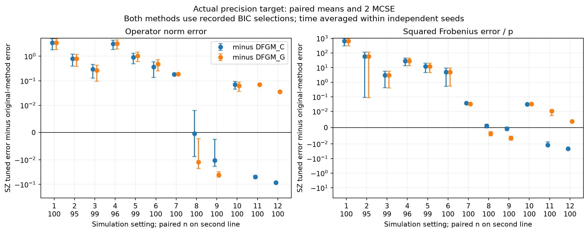

# Completed comparison of our DFGM implementations, October 26, 2026

**EMPIRICAL.** All 1200 paper simulation datasets have completed and passed the
full source/coverage/selection/ROC checks. The new spectral comparison has
completed all 240 paired paper datasets and 1600 controls. This report compares
our implementations on shared simulated observations. Matching the authors'
published numerical tables is not an objective.

The results do not identify a uniformly preferable method. DFGM_C and DFGM_G
have smaller errors than BIC-tuned SZ in the six common-schedule settings.
On irregular schedules, conclusions depend on the loss and original comparator.
Tuned SZ has smaller squared Frobenius error than DFGM_C in settings9,11,12,
but smaller error than DFGM_G only in settings8,9. The new spectral method's
prespecified fixed calibration returns zero throughout; its empirical selector
has substantial PD/BIC missingness and does not improve the control comparison.
These are numerical results for the recorded protocols, not risk-domination
or minimax claims.

## Scope and statistical units

Original comparators and default/tuned SZ use100 fixed seeds per 12 settings.
ACLIME, l2-ACLIME and spectral primary comparisons use the common first 20 seeds
per setting. The original own-method scope amendment followed observed runtime
and partial prior results; it is not presented as a prospectively planned
100-replicate comparison. Seventy-two extra completed ACLIME/l2 datasets are
preserved outside the primary summaries. The new spectral calibration/menu
were fixed before inspecting that method's truth losses.

Each Monte Carlo unit is an independent subject dataset/seed. Losses are
averaged over all intended evaluation times within a seed, then paired seed
contrasts and MCSE are computed. A replicate with a missing selected time is
excluded from complete-curve selected summaries, with its missingness reported.
It is never replaced by zero, a baseline estimate or an average of available
times. Undefined graph rates remain missing per quantity.

The actual precision of the Fourier-projected data-generating process is
primary. Nominal dynamic precision is retained as a separately labeled target.
The two targets can have different graph supports. All operator, Frobenius,
squared Frobenius/p, FPR, TPR and fitted-path ROC quantities remain available
in the saved reports. Full AUC requires the recorded fitted path to cover its
endpoints; missing full AUC is not replaced by partial area.

## Tuned SZ versus both original DFGM implementations

**EMPIRICAL.** Differences below are SZ tuned minus the original method.
Negative differences favor SZ. Parentheses contain paired MCSE, not standard
deviations of time points. Both methods use their observed-data BIC selections;
complete-pair counts are explicit. The six-SZ menu remains the recorded protocol.

| Setting | Schedule / p / visits | Pairs | Operator − DFGM_C (MCSE) | Operator − DFGM_G (MCSE) | Squared Frobenius/p − DFGM_C (MCSE) | Squared Frobenius/p − DFGM_G (MCSE) |
|---|---|---:|---:|---:|---:|---:|
|1|Common /50 /10|100|3.503 (0.831)|3.51 (0.832)|642 (167)|642 (167)|
|2|Common /50 /25|95|0.8037 (0.203)|0.7885 (0.203)|57.48 (28.7)|57.47 (28.7)|
|3|Common /50 /50|99|0.296 (0.0841)|0.263 (0.0838)|2.972 (1.28)|2.966 (1.28)|
|4|Common /100 /10|96|3.186 (0.658)|3.287 (0.658)|28.94 (7.86)|28.96 (7.86)|
|5|Common /100 /25|99|0.9101 (0.212)|1.036 (0.212)|12.17 (3.81)|12.2 (3.81)|
|6|Common /100 /50|100|0.3628 (0.114)|0.4804 (0.114)|4.957 (2.21)|4.982 (2.21)|
|7|Irregular /50 /6–9|100|0.1828 (0.00751)|0.1872 (0.00783)|0.03743 (0.00147)|0.0319 (0.00144)|
|8|Irregular /50 /20–30|100|-0.0003965 (0.00423)|-0.01247 (0.0051)|0.001035 (0.000592)|-0.003709 (0.000673)|
|9|Irregular /50 /50|100|-0.01054 (0.00403)|-0.04071 (0.0049)|-0.0006062 (0.000503)|-0.006491 (0.000618)|
|10|Irregular /100 /6–9|100|0.06926 (0.012)|0.06262 (0.0128)|0.03125 (0.00144)|0.0331 (0.00135)|
|11|Irregular /100 /20–30|100|-0.0501 (0.0036)|0.06983 (0.00395)|-0.01158 (0.00144)|0.01034 (0.00146)|
|12|Irregular /100 /50|100|-0.08572 (0.00272)|0.03621 (0.00122)|-0.02103 (0.000555)|0.003848 (8.43e-05)|

The large common-schedule errors and MCSE remain visible. PD selection does not
ensure low matrix-estimation error. Choosing only DFGM_C as the reference would
also overstate SZ's advantage in the p100 irregular settings, where DFGM_G is
a stronger comparator. All other applicable original comparators remain in the
CSV summaries and paired tables.



## Returned matrices versus PD-screened selections

**EMPIRICAL.** Default SZ returned finite curves for all 1200 datasets, with
no default fitting failures. Only 708 curves were positive definite at every
evaluation time. The other492 have at least one non-PD slice. Their finite
matrix losses remain in the returned-matrix summaries. These are different
populations from BIC-selected summaries, including the six-penalty SZ selector.

The implemented SZ pipeline eigenvalue-clips the noise-corrected covariance
before scaled-lasso inversion. These results concern that pipeline. They do not
establish functional risk domination by literal Sun–Zhang scaled lasso. Tuning
uses observed-data BIC for paper datasets and held-out covariance residuals for
controls, with no selection using the test-truth losses.

The full1200 returned-matrix supplement reports three matrix losses and graph
rates for default SZ and selected rates for every applicable original
comparator. It retains per-seed values, paired sample counts, PD counts and
undefined-rate missingness. Controls did not save their old baseline graph/PD
diagnostics, so those quantities are explicitly unavailable rather than refitted.

## Own proposals and selection coverage

l2-ACLIME refers to an l2 bound on covariance-bias vectors, not a ridge penalty
on the precision columns. The spectral method is a distinct modification,
with the fixed data-derived column bound and both bias-radius constraints.
It is not another name for SZ. No PSD precision repair was added.

**EMPIRICAL.** The table counts complete actual-target operator-loss curves in
the common first 20 seeds. Candidate convergence, pointwise selection and a
complete selected curve are separate outcomes. All 20 datasets exist in every
cell; a zero here means no complete selected curve, not absent simulation data.

| Setting | ACLIME /20 | l2-ACLIME /20 | Spectral tuned /20 |
|---|---:|---:|---:|
|1|15|9|0|
|2|19|15|0|
|3|19|17|0|
|4|17|13|0|
|5|14|11|0|
|6|16|15|0|
|7|0|0|0|
|8|17|12|0|
|9|20|20|7|
|10|0|0|0|
|11|5|8|0|
|12|20|20|0|

The fixed spectral score2 returns analytic zero optima on all data/times, with
finite norm losses but no positive-definite likelihood selections. The six-score
variant has 3120/5920 valid paper evaluation times and only 7/240 complete curves.
At 1913 of 2800 missing times, every optimal candidate has an analytic zero
column, whose preserved zero diagonal prevents strict PD. At the other887,
an optimal candidate without analytic zero columns still fails the PD screen.

In all 16 known-target controls, held-out tuned SZ has smaller mean operator
and squared Frobenius/p loss than the new tuned spectral method,100 pairs per
configuration. Earlier control reports also retain the original ACLIME/l2
comparison and its adverse findings. Controls use the same160/40 training/holdout
split, observations and noise as the existing campaign. Their scope is not a
substitute for the paper simulation settings.

The [spectral report and timing](SPECTRAL_COMPARISON_20261026.md) document all
prespecified constants, empirical versus certified class inputs, unit/domain
transport, failures and source variants. Its old17-baseline-pending snapshot is
retained as history; the strict final data below include all 240 baselines.

## Failures, checks and computation

The original source/coverage gate passed all 1200 datasets:1194 completed without
recorded candidate rejections and 6 retain 414 failed candidate fits. These are
preserved outcomes after the unchanged strict solver/cold-retry policy. Five
of the 300 final producer allocations have FAILED accounting states because of
candidate failures, but every dataset has a checked output receipt. No failed
candidate was silently converted to an accepted solution or replaced by a
reference graph. Original failures, parent sources and checkpoints remain intact.

The gate covers 272520 stored candidate fits and 13954360 metric rows. Of these,
250200 candidate fits belong to the amended primary coverage; the remainder
are the 72 preserved extra proposal datasets. The final saved-array checks reuse
passed independent replays for two unchanged datasets,26598 metric rows, maximum
BIC discrepancy6.55e-11 and norm discrepancy4.27e-14. This is bounded independent
replay plus full structural/source/selection validation, not independent
recomputation of every matrix loss on all 1200 datasets.

The strict spectral reporter verified all 1840 new datasets and all 240 paired
paper baselines. It retains 35520 paper candidate-time outcomes:27767 optimal,
7566 certified-infeasible fallback and 187 numerical failures. Controls retain
7198/2401/1 out of 9600. These are candidate-time counts; the old pipeline's
414 failures count whole candidate-curve fits, so their denominators differ.
All column statuses and accepted-fit residuals remain saved. The five-case
independent spectral replay checked 996 rows; maximum norm/score discrepancies
were 8.17e-14/7.28e-12. Implementation checks do not prove minimaxity.

**EMPIRICAL.** Controlled one-CPU warm six-candidate timing took 11.14s/77.75s
for the spectral method versus0.221s/0.867s for SZ on two saved p50/p100 points.
For full six-score spectral curves, four private workers took 93.00s (p50,
21times,13widths) and 2255.36s (p100,50times,17widths). These are bounded timing
measurements, not universal speedups or matched-accuracy claims. Fixed spectral
is cheap because its answer is zero. Original ACLIME/l2 durations saved per
candidate are amortized path time divided by 31, not separately timed candidate
solves. Total menus, fitting, covariance, calibration, symmetrization and scoring
remain separately identified. Invalid frozen spectral aggregate precision clocks
are qualified; separate private-clock benchmarks supply valid wall-time evidence.
The old155-versus6 menu ratio is not an algorithm-only speedup.

## Reproduction and saved reports

[Final evidence](../validation/2026-10-26-final-comparison/) includes:

- original 1200/: complete coverage, source locks, selected summary/paired losses,
  selection/ROC missingness, independent replay inputs and figures;
- returned1200/: returned default-SZ losses before PD screening, selected norm
  and graph losses for all applicable comparators, per-seed values and PD counts;
- spectral1840/: complete paired new-method report with no pending baselines,
  all three matrix losses, graph/PD/ROC coverage, failures and qualified timing;
- recipes/: exact Slurm payloads, source files, intents and returned job IDs.

Large CSV/JSON files are gzip-compressed without changing their contents.
[The frozen Julia runtime](../validation/2026-10-26-spectral/environment/) includes
Project/Manifest and source hashes. All core runtime files match published
d284642 byte for byte; all seven frozen v5 spectral files match 8c51105; the
corrected persistent dispatcher matchescaa 3a84. Current-master package CI is a
separate environment. Do not update the campaign Manifest to recreate results.

On Discovery, ROOT is
/project2/mkolar_1314/FunctionalGraphicalModels/20261025-direct.
These are completed reporting payloads to run under Slurm in a new output
folder; they do not fit or resimulate datasets:

```sh
python3 "$ROOT/spectral-report-full-v3/report.py" "$ROOT" "$NEW_OUTPUT" --require-complete
python3 "$ROOT/returned-scaled-report-v2/report.py" "$ROOT" "$NEW_RETURNED_OUTPUT"
```

Original reporter13447246 completed 4m12s, strict spectral13448698 completed 1m5s,
returned/graph13449134 completed 1m12s, final spectral figures13448847 completed 4s,
and paired comparison figure13449641 completed 3s. All transferred report/figure
archives matched their recorded SHA256. No primary fit was rerun to generate
these reports. Canonical mathematical notes remain unedited. Conditional theory
and empirical calibration extensions are distinguished in the method protocol.
