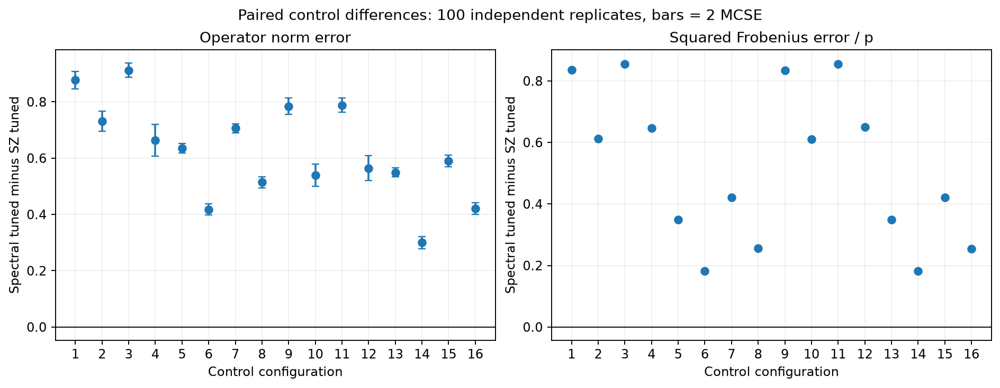
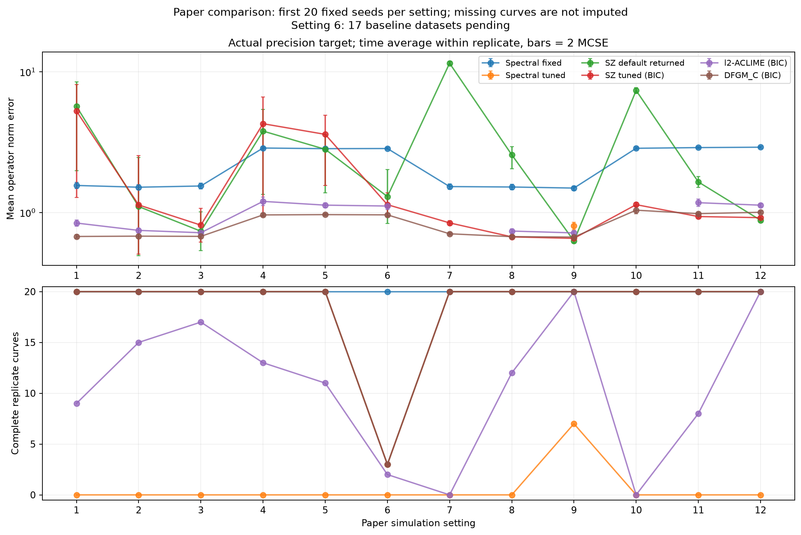
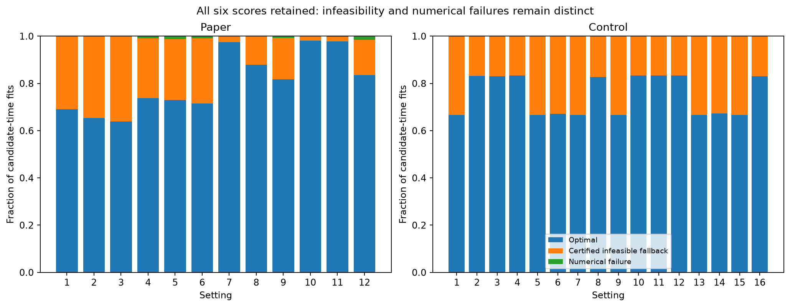
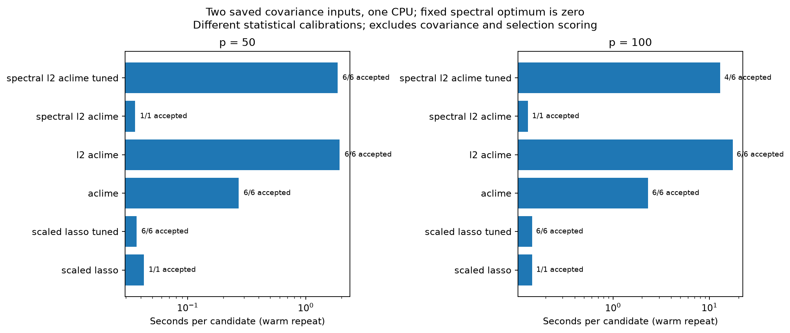

# Spectral SOCP comparison: completed new fits, October 26 snapshot

**Historical partial-baseline snapshot.** The [completed comparison](IMPLEMENTATION_COMPARISON_20261026.md) now verifies all original1,200 datasets and all240 paired baselines. The earlier figures and counts below remain a dated record.

**EMPIRICAL.** The new estimator has completed all 240 paired paper datasets
(first 20 fixed seeds in each of 12 settings) and all 1600 paired controls
(100 seeds in each of 16 configurations, original160/40 split). The exact grid,
fixed score2 and separate six-score empirical menu were prespecified in
[SPECTRAL_L2_ACLIME.md](SPECTRAL_L2_ACLIME.md). Existing baseline estimates,
seeds, latent data, schedules, noise, targets and failures were preserved.

**STATUS.** Report13448697 includes all 1840 new outputs and 223 completed paper
baseline datasets. Seventeen setting 6 baseline datasets remain computationally
incomplete in this snapshot. They are not selection failures. Their five
checkpoint-recovery pools are13447239/41/42/44/45. Original1200-dataset
reporter13447246 is followed by strict full-comparison reporter13448698.
This document is a dated partial-baseline report; it does not claim that the
original campaign or final comparison is complete.

## Accuracy and selection

**EMPIRICAL.** Under fixed Kscore=2 the new method returns the zero matrix for
every dataset/time. This is a genuine analytic optimum, not numerical failure
or an infeasible fallback: if every diagonal score allowance is at least1,
beta=b=t=0 is feasible and attains the nonnegative objective's minimum.
The recorded calibration satisfies this condition. In fact,
`d_j*B_j=2*kappa_bound` implies
`lambda[h,j,j]>=Kscore*sqrt(2*kappa_bound)*(sqrt(ell)+ell)`.
When this data-independent lower bound is at least1, every column has the
analytic zero optimum, regardless of the observed covariance. The zero matrix is never
positive definite, so its norm losses and empty graph remain visible while
its likelihood-selection coverage is zero. This calibration is too conservative
for useful finite-sample estimation in these experiments.

**EMPIRICAL.** The empirical six-score version has greater mean operator and
normalized squared Frobenius error than held-out tuned SZ in all 16 controls.
The table gives spectral tuned minus SZ tuned, with paired MCSE in parentheses.
Each row uses100 independent paired replicates. Positive values favor SZ.

| Control | Operator difference (MCSE) | Squared Frobenius / p difference (MCSE) |
|---|---:|---:|
| 1 | 0.8772 (0.0154) | 0.8356 (0.0012) |
| 2 | 0.7314 (0.0182) | 0.6122 (0.0021) |
| 3 | 0.9120 (0.0127) | 0.8552 (0.0011) |
| 4 | 0.6630 (0.0284) | 0.6467 (0.0023) |
| 5 | 0.6352 (0.0085) | 0.3494 (0.0005) |
| 6 | 0.4175 (0.0097) | 0.1818 (0.0007) |
| 7 | 0.7063 (0.0082) | 0.4217 (0.0005) |
| 8 | 0.5139 (0.0096) | 0.2559 (0.0005) |
| 9 | 0.7845 (0.0148) | 0.8342 (0.0012) |
| 10 | 0.5398 (0.0197) | 0.6102 (0.0021) |
| 11 | 0.7884 (0.0128) | 0.8554 (0.0012) |
| 12 | 0.5643 (0.0221) | 0.6497 (0.0025) |
| 13 | 0.5493 (0.0083) | 0.3496 (0.0005) |
| 14 | 0.3003 (0.0108) | 0.1823 (0.0006) |
| 15 | 0.5909 (0.0104) | 0.4208 (0.0005) |
| 16 | 0.4210 (0.0100) | 0.2549 (0.0005) |

**EMPIRICAL.** Paper BIC requires positive-definite candidates. Only 7/20 seeds
in setting 9 have an accepted spectral selection at every evaluation time;
all other settings have0/20 complete spectral-selected curves. These failures
are preserved rather than filled with reference estimates or averaged over
only the favorable times. Pointwise returned/PD counts are in pd-coverage.csv;
ROC coverage and missing full AUC are separate. On the seven complete paired
setting 9 seeds, the operator difference versus tuned SZ is 0.2215 (MCSE0.0151),
and versus DFGM_C it is 0.1962 (0.0141). These are selected complete cases and
cannot establish performance on the missing233 seeds. The graph differences
below use that same restricted population. Higher TPR and FPR indicate a
different recovery tradeoff; neither rate alone establishes superiority.

| Setting 9 quantity | Spectral tuned − SZ tuned (MCSE), 7 pairs |
|---|---:|
| operator | 0.2215 (0.0151) |
| frobenius | 0.4538 (0.0306) |
| normalized_squared_frobenius | 0.0354 (0.0016) |
| tpr | 0.0143 (0.0029) |
| fpr | 0.0156 (0.0026) |

**EMPIRICAL.** The fixed zero estimator has finite matrix-error losses regardless
of definiteness. Selected baseline summaries condition on their recorded BIC
selections. SZ default returned matrices are additionally reported before PD
screening. These are different populations. All three matrix losses, TPR/FPR,
actual/nominal targets, paired sample counts and MCSE appear in the CSVs.
Controls did not retain baseline graph or PD diagnostics; those quantities are
marked unavailable rather than recovered through baseline refits.

The actual Fourier-projected precision target is primary. The nominal precision
is secondary and explicitly labeled. No objective here requires reproducing
published numerical tables. Common versus independent schedules, boundary
handling, known-zero direct centering versus estimated FDA means, and nonunit
noise remain empirical protocol extensions. Paper L=1/kappa_bound=10 are sensitivity
inputs, not certified class bounds. Control kappa2 and the supplied operator
curvature overbound are documented in the protocol.





## Outcomes and missingness

All 6 scores at every time remain recorded, including rejected candidates.
The counts below are candidate-time outcomes, not independent replicates.
A candidate with a certified-infeasible column receives the explicitly labeled
zero-column fallback; it is excluded from optimal-candidate primary summaries.
Numerical failures are never called mathematical infeasibility or optimality.

| Cohort | Candidate-times | Optimal | Certified-infeasible fallback | Numerical failure |
|---|---:|---:|---:|---:|
| Paper240 datasets |35520|27767|7566|187|
| Controls1600 datasets |9600|7198|2401|1|

Paper column-level records contain334612 infeasible and 327 numerical-failure
columns; controls contain94299 and 1. The full columns, solver statuses,
primal residuals, all-time cap checks and original failure logs remain at the
frozen outputs. All 1840 independent output checks passed; this means correct
accounting and accepted-fit residuals, not that every candidate converged.
A bounded independent saved-matrix replay13448207 checked 996 rows across five
cases, with maximum norm discrepancy8.17e-14 and score discrepancy7.28e-12.
The72 focused implementation tests and 26 finite-sample truth-feasibility checks
validate implementation, not adaptive risk guarantees or minimaxity.



## Why the BIC selections are missing

**EMPIRICAL.** Read-only job 13448886 examined all 35520 saved candidate-time
statuses and 5920 evaluation times. It performed no fits, eigenvalue
computations or truth-based tuning. There are3120 selected evaluation times
and 2800 without a selection. Complete-curve reporting requires a valid
selection at every time, which leaves 7/240 complete replicate curves. For
example, setting 9 has 402/420 selected times but only 7/20 complete curves.
A missing complete curve does not mean every pointwise fit failed.

**PROVED (exact arithmetic).** An analytic zero column has diagonal zero.
The existing symmetrization preserves that diagonal, and the radial cap cannot
make it positive. Positive definiteness requires every diagonal to be positive.
Thus an optimal candidate with such a column cannot pass a strict PD screen.

**EMPIRICAL.** At 1913 of the2800 missing times, every optimal candidate has an
analytic zero column. At the other887 times, at least one optimal candidate
has no analytic zero columns but is still non-PD. The saved statuses never
report a PD optimal candidate with an analytic zero column. This identifies
one structural source of missingness; it does not explain every non-PD matrix.
The calibration and selection policy remain unchanged.

| Setting | Intended times | Selected times | All optimal candidates have a zero column | Other missing times | Complete curves /20 |
|---|---:|---:|---:|---:|---:|
| 1 | 200 | 30 | 150 | 20 | 0 |
| 2 | 500 | 186 | 222 | 92 | 0 |
| 3 | 1000 | 445 | 310 | 245 | 0 |
| 4 | 200 | 35 | 131 | 34 | 0 |
| 5 | 500 | 68 | 301 | 131 | 0 |
| 6 | 1000 | 129 | 637 | 234 | 0 |
| 7 | 420 | 345 | 41 | 34 | 0 |
| 8 | 420 | 380 | 35 | 5 | 0 |
| 9 | 420 | 402 | 17 | 1 | 7 |
| 10 | 420 | 340 | 42 | 38 | 0 |
| 11 | 420 | 380 | 8 | 32 | 0 |
| 12 | 420 | 380 | 19 | 21 | 0 |

[Source, per-time reasons and receipts](../validation/2026-10-26-spectral/selection-diagnosis/)
retain the distinction between candidate convergence, pointwise selection and
complete replicate curves. The separate known-target controls select by finite
held-out residual without a PD screen, so their norm comparisons include a
different population. No missing paper selection was filled with a control or
baseline estimate.

## Precision cost, with covariance and selection excluded

**EMPIRICAL.** Controlled job 13447505 uses two existing covariance inputs,
one middle time each, one CPU on AMD EPYC7513, one solver thread, a first call
and a retained warm repeat. It does not generate new datasets or replace any
primary estimates. Original ACLIME/l2 menus use six K2 positions at fixed bias1;
SZ and spectral use their recorded six penalties/scores. Different calibration
and constraints remain. The table reports warm-repeat total precision time,
including each API's calibration/symmetrization, but excluding covariance
construction and selection scoring. Divide by candidate count for the shown
mean candidate time; this is not an independent-replicate timing experiment.

| p | Method | Candidates | Accepted | Total seconds | Seconds / candidate |
|---|---|---:|---:|---:|---:|
| 50 | scaled_lasso | 1 | 1 | 0.0425 | 0.0425 |
| 50 | scaled_lasso_tuned | 6 | 6 | 0.2209 | 0.0368 |
| 50 | aclime | 6 | 6 | 1.6206 | 0.2701 |
| 50 | l2_aclime | 6 | 6 | 11.6112 | 1.9352 |
| 50 | spectral_l2_aclime | 1 | 1 | 0.0359 | 0.0359 |
| 50 | spectral_l2_aclime_tuned | 6 | 6 | 11.1435 | 1.8573 |
| 100 | scaled_lasso | 1 | 1 | 0.1452 | 0.1452 |
| 100 | scaled_lasso_tuned | 6 | 6 | 0.8667 | 0.1445 |
| 100 | aclime | 6 | 6 | 13.8732 | 2.3122 |
| 100 | l2_aclime | 6 | 6 | 104.3900 | 17.3983 |
| 100 | spectral_l2_aclime | 1 | 1 | 0.1315 | 0.1315 |
| 100 | spectral_l2_aclime_tuned | 6 | 4 | 77.7549 | 12.9591 |

The p100 spectral six-score path includes two certified-infeasible candidates;
all timings, including rejected outcomes, are retained. Fixed spectral is cheap
because its optimum is identically zero. Its small running time is not evidence
of useful estimation or an algorithmic advantage at matched accuracy. The warm
six-score spectral path takes11.14s at p50 and 77.75s at p100, compared with 0.221s
and 0.867s for six SZ penalties on these inputs. These two cases support no
universal speed claim.

**TIMING LIMITATION.** Frozen v4/v5 parallel workers captured a shared clock.
Their aggregate fit_wall_seconds and fit_path_sum_seconds are unreliable and
are explicitly qualified in runtime.csv. Per-column model/setup/solve/residual
timers and covariance/scoring timers remain valid. The public driver is fixed;
frozen sources and estimates are untouched. Controlled benchmark clocks are
private to each call. The separate two-case full-curve timing repair13448656 completed in 39m16s.
It reused saved covariances with four private time workers. Both cases' counts
of optimal, infeasible and numerical outcomes match their primary fits.
The independent clocks also passed the recorded concurrency checks.
The historical155-versus6 whole-menu ratio is not an algorithm-only speedup.



**EMPIRICAL — full curves.** On the same AMD EPYC7513 allocation, one solver
thread per time worker, the six-score exact-grid precision phase took 93.00s
for setting 7/seed1 (p50,21 times,13 widths) and 2255.36s for setting 6/seed1
(p100,50 times,17 widths). The first case includes JIT; the second follows
in the same process. These are single measurements, not replicated timing
experiments. The table distinguishes whole-phase wall time from sums of
elapsed stage latencies across parallel time tasks; those sums are not CPU time.
Covariance construction, checkpoint I/O, likelihood scoring and error evaluation
are excluded. Their valid original stage records remain separately labeled in
runtime.csv.gz; invalid aggregate precision clocks are never substituted.

| p | Candidate-times | Accepted / infeasible / numerical | Precision wall seconds | Sum of column-path elapsed seconds | Sum of symmetrization seconds | Sum of cap seconds | Grid calibration seconds |
|---|---:|---|---:|---:|---:|---:|---:|
|50|126|123 /3 /0|93.000|324.510|8.281|0.184|0.5093|
|100|300|215 /83 /2|2255.357|8301.304|68.037|0.0045|0.000068|

[Source, job script, timing receipts and outcome-count check](../validation/2026-10-26-spectral/controlled-curve-timing/)
identify Julia1.13.2, the frozen runtime, numerical program hash and hardware.
No primary matrices or baseline fits were replaced by these measurements.

## Source and recreation

Numerical implementation commit8c51105 and public compatibility/report/clock
repair ea10f57 are distinct from frozen execution snapshots. All production
numerics use spectral-20261026-v5-source with preserved v4 canaries; its
src/spectral_direct.jl SHA256 is
f0507fed16b485dbb4b17b4b9c3e560c8c0616926df1315550f6eb439b0be1df.
The actual corrected persistent dispatcher is spectral-dispatch-v1; do not
substitute the older top-level batch utility. Journals identify85 production
pools and every returned job ID. Input view spectral-input-view-v1 preserves
original cached data even when missing baseline output links are recovered.
Final comparisons read completed canonical baselines, retaining input provenance.

On Discovery, let ROOT be
/project2/mkolar_1314/FunctionalGraphicalModels/20261025-direct.
The committed source manifests and dispatch recipes are in
validation/2026-10-26-spectral. Commands below are job payloads to run under
Slurm with the recorded resource/environment settings; reporting never fits.

```sh
python3 "$ROOT/spectral-report-full-v3/report.py" "$ROOT" "$NEW_OUTPUT"
# Strict final report, after original reporter13447246 succeeds:
python3 "$ROOT/spectral-report-full-v3/report.py" "$ROOT" "$NEW_FINAL_OUTPUT" --require-complete
# Figures from saved report and controlled timing:
python plot_spectral_comparison.py "$NEW_OUTPUT" "$ROOT/outputs/spectral-controlled-timing-13447505" "$NEW_FIGURES"
```

[Saved report and exact recipes](../validation/2026-10-26-spectral/paired-comparison-1840-current/)
include every dataset key, mean/paired-MCSE/coverage/failure table, source and
hardware fields, gzip-compressed large CSVs, and the dated receipt. The transferred
report/figure archive SHA256 is
b116139b12cdbaf844168e37a7b900d5663ffd2f9af5c12fe029155b154131e4.
[Controlled timing source and raw receipts](../validation/2026-10-26-spectral/controlled-timing/)
retain first-call, repeat and failed-candidate outcomes.

**CONCLUSION — EMPIRICAL.** The implemented SOCP behaves as specified, but this
prespecified calibration does not improve practical estimation in this study.
Tuned SZ performs better on controls and is much cheaper on the controlled
inputs. Severe PD/BIC missingness limits the new method's paper comparisons.
These findings do not refute conditional asymptotic bounds under their stated
assumptions. They do not justify uniform risk domination by SZ. Constants have
not been changed after inspecting truth loss.
