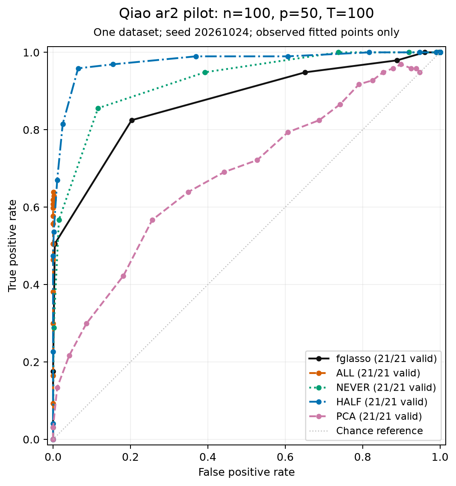

# Initial validation receipt — 24 October 2026

All numerical execution was on USC Discovery through Slurm, using Julia 1.13.2,
2 CPUs, 8 GB, two Julia threads and one BLAS thread per allocation.

| Job | Source at execution | Outcome |
|---|---|---|
| 13350744 | 24b3342 | Foundation suite: 72/72 checks; 25 seconds |
| 13350766 | 388a1f8 | 108 passed; one unqualified `checksquare` error, corrected in the estimator branch |
| 13350788 | 589ad03 | Cancelled after 4m34s stuck in filesystem I/O during setup; tests did not start |
| 13350865 | bace77c | All four model families: 316/316 checks; 2m16s |
| 13350955 | 49c6b8d | Complete suite: 4055/4055 checks, including graph-generator/metric cases; both experiment drivers passed; 1m42s; peak RSS about 1.2 GB |

The CI path repair rebased the stack after source staging. The tested `src/`
tree for job 13350955 and the resulting reproduction branch are identical:
`39f24da31577e3201d2dcbe57e72cc7ddd3ac161`. The rebase changed only the
GitHub workflow's bootstrap path. Logs preserve the original source revisions.

## Numerical scope

- Qiao smoke: n=40, p=6, T=41, true coefficient dimension 5, retained M=3,
  fixed spline L=7, seed 20261024. Three generating models, six penalties and
  two estimators: **36 fits converged; zero failures**. These are integration
  experiments, not the paper's dimensions or data-driven tuning.
- Other-methods smoke: n=80, p=4, two latent components, 13 evaluation points.
  Partially separable joint graphical lasso converged (primal residual
  9.44e-9; dual residual 6.60e-6). Dense and irregular DFGM each produced 13
  finite pointwise CLIME estimates; all happened to be positive definite.
  This does not imply that CLIME always has that property.
- The sparse DFGM latent-graph comparison is descriptive. With bounded sparse
  measurements the target is the conditional-score reconstructed process.
- Small-sample graph performance is not evidence that one method dominates
  the others. No published AUC table or real-data result is claimed here.

Selected numerical outputs and settings are committed under
[`validation/2026-10-24`](../validation/2026-10-24). Full small outputs, saved
supports, the test log and dependency Manifest are in the local ignored
`results/discovery-13350955/` directory. Remote receipts remain at
`/home1/mkolar/juliaPkg/runs/20261024-fgm-development/`.
The parent workspace's `.slurm/runs/20261024-fgm-development.json` records all
attempts, commands and resources. Failed and cancelled attempts are retained.

## Paper-size comparison and extended checks

Job **13351067** passed **4139/4139** tests, including held-out-outcome
non-leakage, invalid-rank candidates, compact kernels, a weighted covariance
smoother oracle and a full-spectrum BLUP oracle. The six-penalty AR(2)
comparison used n=100, p=50, T=100 and seed 20261024. Joint five-fold CV
selected L=10, M=5; the separately tuned M=1 PCA model selected L=10.

One smallest-penalty FGM point did not converge in 10000 iterations at the
default ADMM rho. Its metrics were withheld and the process returned failure.
The other 29/30 method/path points were valid. Its incomplete-path observed-span
trapezoid area was 0.6485, versus 0.9291 for HALF; those coarse values do not
establish a method ranking. Job **13351224** retried only that failed FGM point
with rho=0.05. It converged in 614 iterations (7.54 seconds), with KKT residual
5.16e-6. The statistical objective and penalty were unchanged.

Job **13351238** refined **all five methods** to 21 penalties. Every one of
its **105 method/path points was valid**. It used the same dataset, candidate
CV grids and selection rule; FGM used rho=0.05 and a 30000-iteration limit.
It completed in 1m33s, including dependency setup and a matplotlib export.
No full unit-test rerun was needed: the package `src/` and `test/` trees were
unchanged from the 4139-check run (`8db8078f703991e81d615176f92e6d4570d7a404`
and `4de1b57f8d5eafe01508b751eb591c5989e888f0`, respectively).

| Method | Observed FPR span | Area over that span | Full fitted-path AUC |
|---|---|---|---|
| FGM | 0–1 | 0.87037 | 0.87037 |
| ALL | 0–0.001773 | 0.001120 | Withheld: no complete fitted endpoint |
| NEVER | 0–1 | 0.92582 | 0.92582 |
| HALF | 0–1 | 0.97622 | 0.97622 |
| PCA | 0–0.947695 | 0.63089 | Withheld: no complete fitted endpoint |

**The reported published ordering was not reproduced in this realization.**
HALF outperformed FGM on the sampled path. This is one dataset, one graph
model and a finite grid. It neither reproduces the paper's 100-replicate table
nor refutes its averaged conclusions. No output or adverse result was removed.
ALL and PCA require further fitted-path coverage before full AUC comparison.

[Selected metrics, CV folds/losses and settings](../validation/2026-10-24/paper-pilot)
are committed. Full supports, per-timepoint solver diagnostics, logs and runtime
Manifests are retained in local ignored `results/discovery-13351067/` and
`results/discovery-13351238/`, and the remote run directory. Exact resolved
dependencies are also saved as `DependencyManifest.toml` in the committed
receipt directory. The numerical source revision of the refined run is
`1da2698936915ff25cdfab0f9fe6e0de41a43c1c`.

The coarse run's environment revision label was mistyped at submission. Its
original settings remain intact. `coarse-source-receipt.toml` records the
actual staged git-archive source, `5eef1cebd0cbff1d5a13c2f5d1c698a14d64dad1`.
The refined run's revision label is correct. Render-only job **13351334** (2 seconds, 1 CPU, 2 GB) fixed
figure-margin spacing without changing the fitted results.

