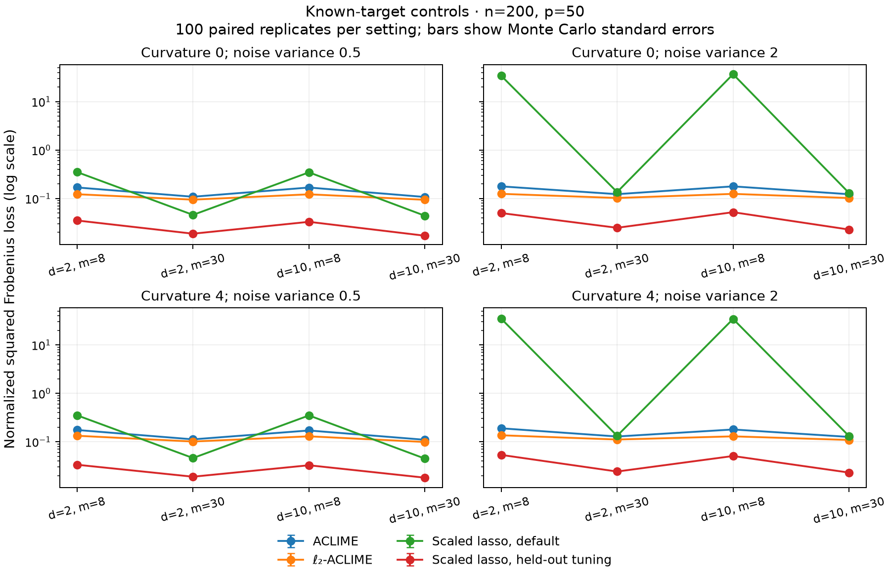

# Expanded DFGM campaign: controls verified; paper study running

**Status on 25 October 2026:** all 1,200 paper datasets have been submitted
on Discovery. Full published-table replication is not yet established.
See [the protocol](../../docs/CAMPAIGN_20261025.md).

## Completed controls [EMPIRICAL]

The sixteen known-target configurations have **100 paired replicates each**:
n=200, p=50; degree 2/10, visits 8/30, curvature 0/4, noise variance .5/2.
Each dataset uses the same 160 training and 40 held-out subjects for observable
covariance-residual tuning. The ACLIME proposals use a known valid bias envelope
and three K2 values. Scaled lasso retains its default and a separate six-value
held-out penalty menu. No latent precision is used for selection. These controls
do not establish adaptation to unknown bias or smoothness.

Jobs **13414835/13414836** finished. Reporting jobs **13422502/13422680**
verified all 1,600 datasets, 11,200 main fits and 9,600 scaled calibration fits,
with zero failed candidates. The default scaled-lasso replay matched exactly
on all 1,600 datasets. Every summary cell has 100 valid replicates. MCSE use
independent paired replicate differences, not time points.

In these controls, l2-ACLIME has smaller mean operator and normalized squared
Frobenius losses than ACLIME in all sixteen configurations. Held-out tuned
scaled lasso has smaller mean normalized squared Frobenius loss than both
proposals in all sixteen configurations. Its mean operator loss is smaller
than l2-ACLIME in fourteen configurations; the other two differences are small
relative to their paired MCSE. The large losses of default scaled lasso in
noisy sparse schedules remain visible.

For example, configuration 1 (degree 2, 8 visits, curvature 0, noise .5) gives:

| Method | Normalized squared Frobenius mean (MCSE) |
|---|---:|
| ACLIME | .16829 (.00106) |
| l2-ACLIME | .12203 (.00088) |
| Scaled lasso, default | .35008 (.01270) |
| Scaled lasso, held-out tuning | .03500 (.00086) |

These are empirical findings for this controlled construction, not results
from the twelve Biometrika settings. [All paired differences](controls100-comparison/paired-comparisons.csv)
and [four-method summaries](controls100-comparison/summary.csv) retain the full
configuration dependence.

[Main coverage and validation](controls100/report-validation.json),
[scaled replay validation](scaled100/validation.json), and the original separate
figures/CSVs in `controls100/` and `scaled100/` are retained.

## Runtime implementation and remaining numerical failure [EMPIRICAL]

The new path API reuses K2-independent pilots and solver model structure.
See [implementation and numerical checks](../../docs/DIRECT_PATH.md).
Job **13422768** passed all **4,510** package tests, serial/threaded covariance
checks and real p=100 time-path equality checks. Its strict zero-failure pipeline
check failed: one of 101 candidates returned `ALMOST_OPTIMAL`, including after
one fresh identical-program column restart. That candidate remains failed and
is excluded from selection and metrics. No solver tolerance was loosened.

The separate read-only accounting gate **13422783** verified all 101 intended
fits, 100 accepted fits, exactly one excluded failure, finite successful losses,
and selection/ROC consistency. This gate validates failure handling; it does
not turn the numerical failure into a converged estimate. Its receipts and
the original failed log are in [runtime/](runtime/source-receipt.json).

The production source is immutable `path-driver-v4-source`, with archive and
per-file hashes in that receipt. All 1,200 datasets are dispatched as 300 pools,
jobs **13422784–13423083**. Each has four 4-CPU workers, 32 GB total and a
12-hour limit. Completed covariance/target inputs from the superseded cold
canary are reused only after provenance checks. All source variants, earlier
OOM/timeouts, nonconvergence and partial outputs remain on Discovery.

## Earlier reduced checks

Job 13413022 passed 101 bias-menu canary fits. Job 13413942 checked candidate
counts, BIC-to-ROC bias selection, retained covariance inputs, four-replicate
loops and exact default replay. Re-summarizing the older 288-fit calibration
reproduced its summary byte-for-byte. Those artifacts remain reduced checks,
separate from the completed 100-replicate controls and running paper study.

The workspace registry `.slurm/runs/20261025-dfgm-paper.json` and submission
journal identify exact live jobs. The full paper report still requires coverage,
paired uncertainty, missingness, target reconciliation and source-identified
reference-table comparisons. A scheduler exit alone is insufficient.

## Common-grid computation update [EMPIRICAL]

The [exact common-grid mean/CV and product-moment shortcut](../../docs/COMMON_GRID_COMPUTATION.md)
passed full p=100 reconstruction and rank comparisons (job 13423276), then the
101-fit end-to-end gate (13423280;100 accepted, 1 excluded conic failure). The
complete reconstructed covariance matched the saved frozen result within
2.80e-14; all 100 ranks matched. A representative mean CV component took 27.23 s
versus 0.0612 s. These are bounded timing checks.

All 125 waiting common-grid pools (500 datasets) were replaced with this validated
implementation and shorter wall limits. Running jobs retained their source.
[Receipts and CSV timings](common-fast/source-receipt.json) identify both source
variants. Canonical dataset links and the aggregation dependency preserve all
1,200 intended datasets. All four CI platforms passed on436c780 before this
implementation update; inspect the latest commit's checks separately.

## Reporting replay and missingness [EMPIRICAL]

[Independent saved-array checks](../../docs/REPORTING_CHECKS.md) verified 2,946
reduced-canary metric rows, with maximum BIC/loss differences 1.03e-12/2.14e-14.
Exact row coverage, BIC selection and ROC consistency are checked, and five
corruption/source guards rejected invalid records. All 244 production settings
available at the checkpoint matched the frozen source/protocol locks.

The [missingness tables](reporting/selection-missingness.csv) retain invalid PD/BIC
selections separately from solver failures. The reduced irregular canary has
14/21 missing l2 selections, despite converged fits. This is a coarse canary
finding, not a paper-study conclusion. [ROC missingness](reporting/roc-missingness.csv)
also distinguishes incomplete paths and undefined full AUROC. Reporter 13423668
will apply these checks to the complete campaign and replay two full datasets.
