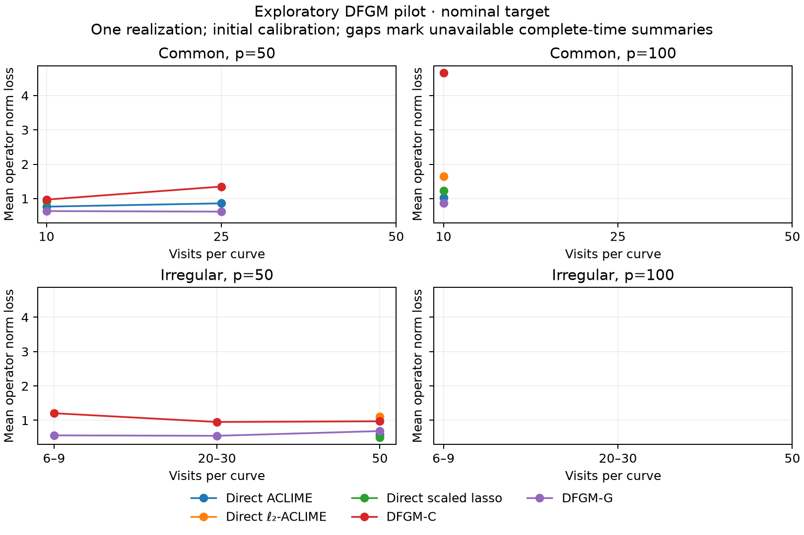
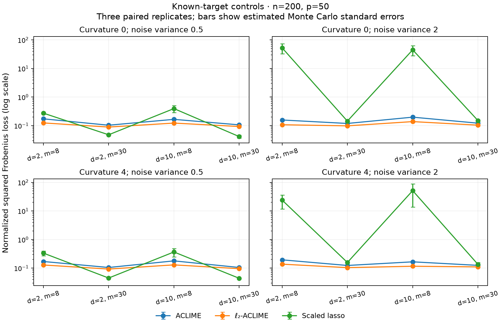
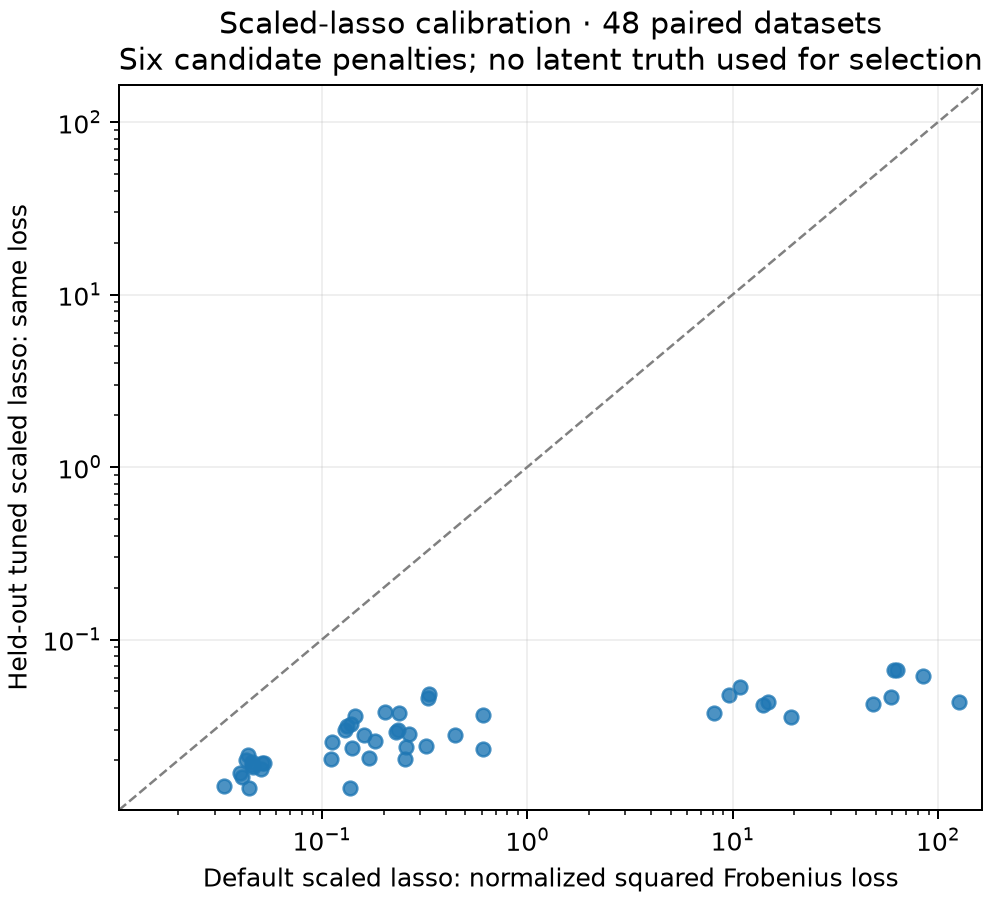

# Direct DFGM: development evidence and incomplete replication

25 October 2026 (Asia/Dubai). All numerical computation and plotting ran in
Discovery Slurm allocations. **The published Biometrika tables have not been
replicated.** This record separates software checks, exploratory results and
remaining paper evidence.

The user subsequently expanded compute authorization. Work now continues
under [the full campaign protocol](../../docs/CAMPAIGN_20261025.md). This report
retains the historical development results and their original coverage limits.

## Implemented and verified

`direct_covariance` estimates pointwise covariance from raw observations.
`fit_direct` supplies bias-aware ACLIME, multiscale ℓ₂ bias-budget ACLIME and
scaled lasso. The ℓ₂ constraint limits smoothing bias; it is not ridge
regularization. Independent uniform, synchronous iid and stratified common
sampling designs have explicit, different pair weights. Boundary equivalent
kernels and scaled lasso on a smoothed projected covariance are empirical
extensions. The independent-schedule theorem is not asserted for these cases.

**VERIFIED SOFTWARE CHECKS:** Discovery job **13384164**, Julia 1.13.2, passed
**4391/4391 package tests**, including Aqua, in 110 seconds on one CPU with
3500 MiB. Coverage includes inclusion probabilities, analytic inverse recovery,
raw diagonal products, conic feasibility, interval symmetrization, scaled-lasso
normalization, reproducible generating designs and corrected stratified pair
weights. The common-grid expectation check exhausts 1024 two-point quadrature
combinations. These checks do not prove a statistical rate.

Step **13383412.12** previously passed 4387 tests and eight backend fits.
Both accelerated covariance helpers matched FDA's raw-product surfaces, noise
estimates and whole-curve CV scores. The irregular helper factors distinct-visit
products into products of sums minus repeated visits; the common helper also
caches smoother matrices. These are exact aggregation changes, not smoothing
approximations. That step used one CPU for 247 seconds, with peak RSS
1,640,052 KiB. The final stratified-design tests add four checks.

**BOUNDED TIMINGS:** [backend.csv](backend.csv) records warm p=50 center-fit
times of 1.93 versus 4.78 seconds for HiGHS versus Clarabel ACLIME, and 4.76
versus 6.28 seconds for ℓ₂-ACLIME. Nonunique valid LP pilot solutions can
differ across backends. [covariance-benchmark.csv](covariance-benchmark.csv)
records fixed-bandwidth reconstruction at p=50,n=100,T=25 in 14.51 seconds,
and small AIC/CV common and irregular cases in 2.40 and 1.86 seconds. These
small timings do not establish production throughput.

Original setup job **13383332** passed 4366 tests. Canary **13383375** retained
one rejected `ALMOST_OPTIMAL` conic fit and failed. After setting Clarabel
tolerances to 1e-7, the repeated common-grid canary completed all 28 fits.
Only `OPTIMAL` primal solutions are accepted. Failures remain in the original
output directories. No failed fit was replaced with an oracle.

## Published-setting pilot: six of twelve datasets complete

Job **13383412** attempted one replicate in each published n,p/sampling
setting with fixed bandwidth and three precision-path candidates. It timed
out after a 75-minute allocation. Settings **1,2,4,7,8,9** completed; settings
**3,5,6,10,11,12** remain incomplete. Completed datasets contain 123 candidate
fits, 108 evaluation times and 4158 metric rows over both targets, with no
recorded fit failure in those completed paths. Partial outputs are retained.
The immutable `pilot-source` uses the original slower reconstruction code
and all-Clarabel backend, separately from the later tested source.

[report-validation.json](report-validation.json) checks expected fit/time
counts, finite losses and explicit coverage. [pilot-coverage.csv](pilot-coverage.csv)
and [pilot-summary.csv](pilot-summary.csv) retain missing selections, incomplete
paths, undefined full AUROC and undefined Monte Carlo SE for a single replicate.
Time points are averaged within a replicate, not treated as independent
replicates. Observed ROC areas and conservative completion bounds are separate
from full fitted-path AUROC. No empty or complete endpoint was invented.

The pilot's direct common-grid fits used the earlier binomial synchronous
approximation. The final source uses corrected five-stratum pair weights;
**those common-grid performance results must be rerun**. The initial
constant-one bias envelope is also exploratory and too small in the diagnostic
below. These plots are development evidence, not a calibrated comparison.



The [actual-target plot](pilot-operator-actual.png) is also retained. Gaps mark
unavailable complete-time selected summaries. The comparator inventory and
remaining bandwidth, DGM-constant, GGL and author-code differences are in the
[protocol](../../docs/DIRECT_DFGM.md).

## Material target and bias findings

**NUMERICAL, seed 1229:** [target-check.csv](target-check.csv) compares nominal
dynamic precision with the inverse covariance of the actual five-Fourier
projected process. Their maximum operator-norm gaps are **0.934922 (p=50)**
and **1.479630 (p=100)**. Refining integration from 101 to 201 nodes changes
the latter precision by at most **0.000368** and **0.000521**, respectively.
This does not attribute an error to the paper: agreement with author code
and its conventions remains unverified. Both targets must be retained and
reconciled before a published-table claim.

Population product-kernel quadrature at widths .15,.25,.4 and 21 time points
gives maximum operator bias divided by h² of **17.592589** and **16.168618**.
Corresponding entrywise values are **15.909674** and **15.520051**. These are
quadrature diagnostics, not certified global suprema. They show that **the
initial constant-one envelope is not valid for the tested design**. More
Monte Carlo repetitions cannot repair that calibration. The driver exposes
`--bias-constant` and `--lp-solver` and records both. A paper comparison needs
a prespecified valid-envelope or separately labeled data-driven calibration
protocol.

## Additional known-target controls

**EMPIRICAL:** 16 settings × 3 paired replicates = **48 datasets**, with
**336 candidate fits and zero fit failures**, completed within job 13383412.
Settings cross degree 2/10, visits 8/30, curvature 0/4 and noise variance .5/2,
at n=200,p=50. Center precision and operator bias envelope are known exactly.
A 160/40 subject split selects K2 from .1,.3,1 using an observable covariance-
precision residual. No latent truth enters tuning. This does not establish
adaptation to an unknown smoothness envelope.

[controlled-coverage.csv](controlled-coverage.csv) checks all 21 fits per
configuration and selected-fit uniqueness. [controlled-summary.csv](controlled-summary.csv)
reports means and Monte Carlo SE across three replicates.
[controlled-paired-differences.csv](controlled-paired-differences.csv) preserves
paired ℓ₂-minus-ACLIME losses. The ℓ₂ method has smaller mean normalized squared
Frobenius loss in these 16 controls, an initial signal with only three replicates.
Scaled lasso does well in some dense-visit, low-noise controls and can have
very large losses under sparse noisy sampling. All adverse results remain
visible on a logarithmic axis.



For degree 2, m=8, curvature 0 and noise variance .5, normalized squared
Frobenius means (MCSE) are ACLIME **.17330 (.00552)**, ℓ₂-ACLIME **.12476
(.00158)** and default scaled lasso **.27401 (.02501)**. These small controls
are not evidence of uniform superiority or replication of the paper.

### Scaled-lasso calibration

The calibration study replays the same 48 datasets and compares the default
quantile penalty with .2,.35,.5,.75 and an explicit visit-adjusted heuristic.
A held-out covariance-precision residual selects the penalty. The heuristic
is empirical, not a consequence of Sun and Zhang's iid theorem. Original
default results and every failed candidate remain retained.

Job **13385219** completed **288/288 fits without failure** in 131 seconds
on two CPUs with 4 GB. [scaled-calibration-validation.json](scaled-calibration-validation.json)
checks all 16 configurations and exactly replays the original default losses
(relative discrepancy zero on every configuration). The
[summary](scaled-calibration-summary.csv) and [paired data](scaled-calibration-paired.csv)
retain all 48 comparisons. In the degree-2, m=8, zero-curvature, noise-.5
control, held-out tuning reduced mean normalized squared Frobenius loss from
**.27401 (.02501)** to **.03007 (.00392)**. At noise variance 2 the same
means were **52.85245 (20.41235)** and **.05048 (.00557)**. These are initial
three-replicate results, not uniform guarantees.



This result changes the practical comparison: default-only scaled lasso is
not a sufficient baseline. The main DFGM driver now retains the quantile
default separately and adds `scaled_lasso_tuned`, a six-penalty path selected
by the same pointwise BIC as other paper-mode methods. This BIC protocol is
distinct from held-out tuning in the controlled experiment. Its visit-adjusted
candidate uses the actual training-subject count and minimum visit resource.
The menu is an empirical extension; theory and paper-size performance remain
unverified. Its reduced pipeline validation is recorded separately below.

Two earlier calibration attempts failed before fitting: **13384835** rejected
a tuple in TOML metadata; **13385105** stopped at its first canary because the
source transfer omitted the ignored Manifest. The final attempt converts the
labels to a vector and reuses the exact validated dependency lock. These
failures remain retained; they are not counted as successful numerical fits.

### Final paper-mode pipeline canaries

Job **13385504** completed the final optimized pipeline with whole-curve
bandwidth CV, AIC rank selection, corrected stratified common-grid weights,
all applicable comparator families and the six-penalty scaled-lasso BIC path.
Both n=30,p=10 datasets completed: **34 common-grid plus 19 irregular candidate
fits, with zero failures**. The job used two CPUs, 4 GB and 94 seconds including
fresh-source initialization. These are reduced software canaries, not paper-size
results. [Coverage](scaled-path-canary/coverage.csv), settings, all fit receipts
and summaries are retained in [scaled-path-canary](scaled-path-canary).
All seven recorded source hashes match the publication source. Job **13385447**
previously passed the 41-fit version without the added scaled-lasso path.

## Recreate and locate the evidence

Discovery root:
`/project2/mkolar_1314/FunctionalGraphicalModels/20261025-direct`.
Research workspace registry: `.slurm/runs/20261025-direct-dfgm.json`.
PR: [FunctionalGraphicalModels.jl #9](https://github.com/mlakolar/FunctionalGraphicalModels.jl/pull/9).

Immutable source directories identify each variant: `pilot-source` generated
`outputs/pilot`; `optimized2-source` produced aggregation/backend checks;
`final-source` generated `outputs/stress` and the target diagnostic;
`stratified-source` passed the final 4391 tests; `calibration3-source` generated
`outputs/calibration3`; `scaled-path-source` generated
`outputs/scaled-path-canary`. Their source archives and
resolved Manifests remain at the root. Individual settings retain seeds,
source hashes, fitted paths, diagnostics, settings and completion receipts.

[DependencyManifest.toml](DependencyManifest.toml) is the tested optimized/final
lock. [InitialDependencyManifest.toml](InitialDependencyManifest.toml) records
the older pilot environment. For exact environment replay, copy the appropriate
lock to `Manifest.toml` in a fresh source checkout and run `Pkg.instantiate()`
under Slurm. `scripts/instantiate.jl` instead resolves current dependency
branches and therefore constitutes a fresh environment.

Representative commands, **inside an authorized allocation**, are:

```sh
julia --project -e 'using Pkg; Pkg.test(;allow_reresolve=false)'
julia --project experiments/dfgm_target_check.jl --out results/target-check
julia --project experiments/direct_stress.jl --setting 1 --out results/stress-1
julia --project experiments/scaled_lasso_calibration.jl --setting 1 --out results/calibration-1
```

Use the project launchers for GNU Parallel plus exclusive one-CPU `srun`
workers. `experiments/make_dfgm_tasks.py --mode paper` renders 1200 dataset
commands with 100 replicates per setting; rendering does not submit them.
Every new attempt requires a fresh output root. Summarizers and plots read
completed reporting inputs without refitting models.

## Remaining paper work and resource authorization

The full 1200-dataset study is **not submitted or completed**. Before treating
it as paper evidence: reconcile actual/nominal targets with author code;
prespecify direct-method bias and scaled-lasso calibration; rerun corrected
stratified designs; validate the final selection path at paper dimensions; complete
all settings and repetitions; compare published quantities with Monte Carlo
errors and retain failures. Matérn controls proposed in the protocol are not
implemented or run.

The development runs above used the slurm-workflow standing allowance: at most eight concurrent
CPUs, 16 GB and 7200 seconds with an allocation running, across attempts.
Overlapping steps inside the pilot do not add allocation wall time. The larger
campaign budget was pending at that checkpoint. The user has since explicitly
expanded compute authorization; current work follows the linked campaign
protocol. This draft remains incomplete as paper evidence.
